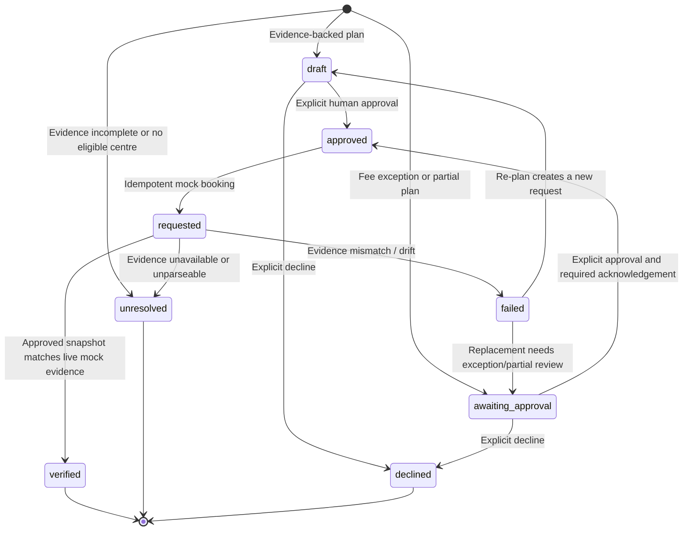

# ReLoop / EcoRoute

ReLoop is a FastAPI and vanilla HTML application for planning synthetic e-waste and recycling pickups. It matches a user's items and location against locally hosted mock recycler pages, shows source evidence, and requires explicit human approval before creating a mock booking request.

> **Demo integrity:** Recycler profiles, source pages, fees, and booking references are synthetic. The app does not dispatch a real collection. A request or verified booking is always described as **“Requested, not yet collected.”** There is no `collected` lifecycle state.

## What it does

- Accepts a basket of up to 10 material types, quantities, location, fee limit, and optional preferred centre. Duplicate material types are merged.
- Fetches and parses mock recycler HTML, retaining source URLs and retrieval timestamps. Missing or unparseable evidence is shown as unresolved.
- Runs deterministic validation, acceptance matching (including PIN prefixes), fee comparison, and plan drafting.
- Optionally lets Gemini sequence backend pipeline tools and produce a strictly validated, two-sentence explanation copied from tool results. Gemini does **not** decide acceptance, fees, approval, or booking.
- Requires a fresh human approval for every booking. Partial plans require explicit acknowledgement; a fee above the limit requires explicit fee-exception approval.
- Submits an idempotent mock booking only after approval, verifies the approved snapshot against live mock pages, records drift, and offers a replacement plan that still needs approval.
- Provides synthetic drift controls and a benchmark UI for the four official cases and separately labelled TC5 bonus.

See [docs/ARCHITECTURE.md](./docs/ARCHITECTURE.md) for the system diagram and agent flow.

## Gemini: exact role and fallback

The planner uses Gemini only when `GEMINI_API_KEY` is configured and `TEST_MODE` is off. It exposes five zero-argument tools over server-side state: `validate_details`, `fetch_recycler_profiles`, `match_items`, `compare_fees`, and `draft_plan`. Gemini can choose their order; the backend enforces dependencies, executes each tool, and runs any remaining pipeline steps deterministically after at most six tool executions.

Backend code remains authoritative for validation, source parsing, material decisions, service area, fees, approval requirements, and booking. Gemini cannot approve or book. Its optional explanation is included only if it consists of exactly two sentences that are verbatim tool-result strings. A 429 or 5xx is retried once. On other Gemini errors, the backend completes deterministically and reports only the exception type in `agent_exception`; no key or exception message is returned.

The separate `/api/assistant` chat endpoint may use Gemini to phrase a reply. Intent extraction remains deterministic, and the chat endpoint does not call planner tools. In `TEST_MODE`, neither the planner nor chat endpoint calls Gemini.

The plan response includes `agent_mode` (`gemini`, `gemini_partial`, or `deterministic`). Every trace entry has an `actor` (`gemini` or `backend`) so the UI shows which steps were actually run by each.

## Local setup

Requires Python 3.10 or newer.

```bash
pip install -r requirements.txt
uvicorn ecoroute.backend.main:app --reload
```

Open `http://127.0.0.1:8000/` for the planner and `http://127.0.0.1:8000/tests` for benchmarks. The app defaults to SQLite when `DATABASE_URL` is unset. To run tests, use an isolated SQLite database:

```bash
TEST_MODE=1 python -m pytest -q
```

PowerShell equivalent:

```powershell
$env:TEST_MODE = "1"
python -m pytest -q
```

Tests set their own temporary database path. `TEST_MODE` prevents external Gemini calls.

## Environment variables

Copy `.env.example` to `.env` for local use. Never commit `.env` or real credentials.

| Variable | Purpose |
|---|---|
| `GEMINI_API_KEY` | Optional server-side key for the Gemini chat and planner orchestration. Never expose it to the browser. |
| `GEMINI_MODEL` | Gemini model name; defaults to `gemini-flash-lite-latest`. |
| `DATABASE_URL` | Optional PostgreSQL connection URL. When unset, the app uses SQLite. |
| `PUBLIC_BASE_URL` | Public application URL used by the mock-source fetcher; local request URL is used as a fallback. |
| `CORS_ORIGINS` | Comma-separated allowed origins, or `*` for the demo default. |
| `DEMO_CONTROLS` | Enables synthetic recycler drift controls; defaults to `1`. Set to `0`, `false`, `off`, or `no` to disable them. |
| `PORT` | Optional local server port convention; Vercel provides its own runtime. |

`GET /api/health` reports database dialect/status, whether a Gemini key is configured, and whether planner orchestration is enabled. It never returns the database URL or Gemini key.

## API overview

| Method | Endpoint | Purpose |
|---|---|---|
| `GET` | `/` | Main planner UI |
| `GET` | `/tests` | Official TC1–TC4 benchmark UI and TC5 bonus |
| `GET` | `/api/health` | Service, database, demo-control, and Gemini configuration status |
| `GET` | `/api/materials` | Supported material IDs and labels |
| `GET` | `/api/recyclers` | Synthetic recycler profiles for the UI |
| `GET` | `/mock-recycler/{slug}` | Synthetic HTML source page; optional `scenario` query for demos |
| `POST` | `/api/demo/scenario` | Set or reset a synthetic drift scenario |
| `POST` | `/api/assistant` | Optional conversational response and deterministic intent extraction |
| `POST` | `/api/requests` | Validate items and create an evidence-backed pickup plan |
| `GET` | `/api/requests?request_id={id}` | Look up one request; the collection is not enumerable |
| `GET` | `/api/requests/{id}` | Look up one request and its approval, booking, verification, and trace |
| `POST` | `/api/requests/{id}/approval` | Approve or decline an eligible plan with required acknowledgements |
| `POST` | `/api/requests/{id}/book` | Submit an idempotent mock booking after approval |
| `POST` | `/api/requests/{id}/verify` | Compare all approved centre assignments with current mock evidence |
| `POST` | `/api/requests/{id}/replan` | Create a new unapproved plan excluding drifted centres |
| `GET` | `/api/tests` | Read persisted benchmark results |
| `POST` | `/api/tests/run` | Run TC1–TC4 and TC5 bonus |
| `POST` | `/api/tests/run/{case_id}` | Run one benchmark case |

The request body accepts `items: [{ "item_type": "...", "quantity": 1 }]`, `city`, `pincode`, `max_fee`, and optional `preferred_centre`. Supported material IDs are returned by `/api/materials`.

## Approval and booking lifecycle



No plan is auto-approved, including plans within budget. Approval stores an immutable snapshot. A replacement plan has its own request ID and cannot inherit approval or booking from the original.

## Database migrations

Schema changes are additive for both SQLite and PostgreSQL. Existing installations gain request location/basket/replacement fields; approval fee-exception and snapshot fields; booking idempotency, approved-snapshot, verification, drift, and hash fields; and `agent_traces.actor` (defaulting old rows to `backend`). The migration code does not drop existing data.

## Deployment

Vercel is the only supported deployment target in this repository. `api/index.py` exports the FastAPI app and `vercel.json` routes requests to it while bundling `ecoroute/backend/**`. Configure the environment variables above in the Vercel project settings. Use PostgreSQL for persistent production data; serverless local files are not a production persistence layer.

Vercel deployment behavior and live Gemini calls require external credentials/runtime access and are not verified by the local test suite. All benchmark evidence is generated by `/tests`; this README intentionally does not include fabricated runtime output or machine-specific local URLs.

## Tests

Run `TEST_MODE=1 python -m pytest -q` from the repository root. The current suite contains 70 tests; the last local run passed all 70. It exercises request validation, multi-item matching, preferred centres, approval and booking safeguards, verification/drift/re-planning, the synthetic benchmark runner, and Gemini orchestration through fake clients. No Gemini network call is made in test mode.

TC1–TC4 are the official scenarios. TC5 is an additional bonus scenario for drift after approval; it is not counted as an official case.

## Scope not implemented

The optional Phase 6 photo-to-items flow is not implemented. No image is uploaded or classified.
