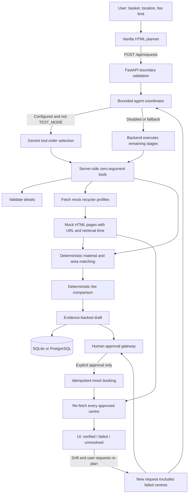

# ReLoop architecture

## Agent architecture

Inputs pass through FastAPI boundary validation into an optional bounded Gemini orchestrator or the deterministic backend path. When enabled, Gemini selects among zero-argument server-side tools; the backend runs dependencies and any remaining stages, and owns all validation, source parsing, acceptance, fees, plan status, approval, and booking decisions. Sources are synthetic recycler HTML pages with captured source URLs and retrieval timestamps. A plan is always presented at the human approval gate before the idempotent mock booking action. Verification re-fetches every centre and compares it with the immutable approved snapshot; mismatches are persisted as drift, unavailable evidence remains unresolved, and a re-plan creates a new unapproved request. The result view exposes the trace actor, evidence, and honest status.

## Operational boundaries

- The planner tool loop has a maximum of six tool executions. Backend code completes stages that Gemini did not execute.
- Gemini explanations are included only when exactly two sentences are copied verbatim from tool-result strings.
- Gemini is never called in `TEST_MODE`; fake clients are used for orchestration tests.
- No tool can approve a plan, create a booking, or report that an item was collected.
- Demo scenarios change only in-memory synthetic recycler profiles. They can be disabled with `DEMO_CONTROLS=0`.
- The optional photo-to-items feature is outside the implemented scope.
